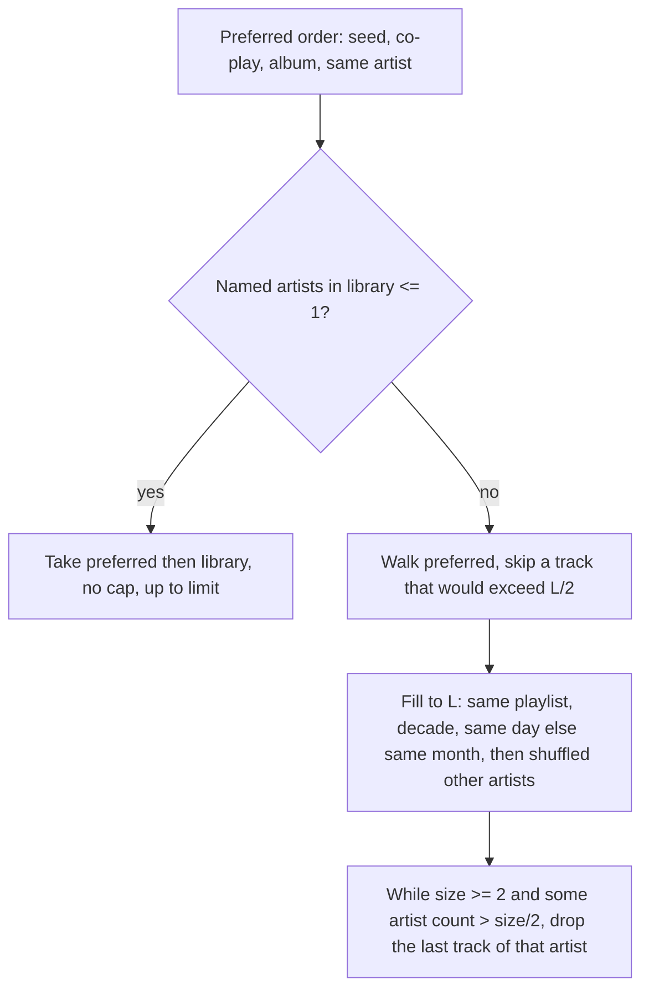

# Generated mixes stay varied instead of one artist

## Description

Someone opening For You often gets a “Because you listen to…” mix that is mostly one artist. The same pile-up can happen in other generated mixes. They want a mix that still feels related to what they listen to, without half the songs (or more) being that same artist.

**Assumption:** “All mixes” means generated mixes the app builds for the user (Daily Mix, Quick Mix, “Because you listen to…”, and any other auto-built mix). It does not mean playlists the user made, or factual lists such as Most Played, Recently Played, and Recently Added.

**Assumption:** Songs count as the same artist when the artist name matches, ignoring letter case. Songs with a blank artist name are not treated as one shared artist.

**Assumption:** “At most 50%” means no single artist has more than half the songs in that mix. On an odd-length mix, one artist must not be a strict majority (for example, at most 2 of 5, or 12 of 25).

**Assumption:** The rest of the mix is filled in this order, using a song already chosen for the mix (including the seed, when there is one) as the reference: another song from the same user playlist, then the same decade, then the same genre, then added to the library around the same time, then a random song by a different artist. A later option is used only when an earlier one cannot fill the mix without breaking the artist cap. “Around the same time” means the same day if that yields songs, otherwise the same calendar month.

**Assumption:** Decade and genre are used only when the app already knows them. This story does not ask the user to fill in missing year, genre, or country.

**Assumption:** If the library has other artists, the mix gets shorter rather than breaking the cap. If the library has only one artist, that artist may fill the mix. A mix of a single song may be that one song.

## Goals and scope

### In scope

- Every generated mix limits any one artist to at most half of its songs.
- “Because you listen to…” is included, and so are Daily Mix, Quick Mix, and other generated mixes.
- Songs beyond that cap come from related music: same playlist, same decade, same genre, added around the same time, or a random other artist, in that order.
- The mix the user opens and plays matches that varied set.

### Out of scope

- User-made playlists and smart lists that are just “most played”, “recently played”, or “recently added”.
- Asking the user to supply missing year, genre, language, or country.
- New For You rows, new mix names, or a new explanation of why each song was picked.
- Changing how much a favorite or a recent play influences ranking, except where that would break this artist cap.

## Acceptance criteria

- [ ] In a “Because you listen to…” mix of 2 or more songs, no artist accounts for more than half the songs.
- [ ] The same cap holds for each Daily Mix and each Quick Mix of 2 or more songs.
- [ ] When the library has songs by other artists, those other artists appear in the mix so the cap is met.
- [ ] When similar songs exist, the songs that replace the extra same-artist tracks are related by playlist, decade, genre, or add time before the mix falls back to random songs by other artists.
- [ ] A library that only contains one artist can still produce a mix of that artist.
- [ ] A one-song mix can still be that one song.
- [ ] Opening a mix and playing it uses the varied list, not a hidden list that is still dominated by one artist.

## Functional requirements

- Each generated mix enforces the artist cap on the list the user sees and plays.
- The seed of a “Because you listen to…” mix may still appear, and still counts toward that artist’s share.
- Related songs are preferred in the order: same user playlist, same decade, same genre, added around the same time, then random songs by a different artist.
- Missing decade or genre does not block the mix; that song is simply not chosen for that reason.
- The mix does not pad with extra tracks from an artist who is already at the cap, unless the library has no other artist.
- Existing mix titles and where they appear stay as they are.

## Non-functional requirements

- Building or refreshing For You should not feel slower than it does today.
- The rule is consistent: leaving For You and coming back on the same day does not randomly drop the cap for one mix and keep it for another.

## UX design

N/A — no new screens, controls, or copy. The user still opens the same mix rows and sees a track list; only which songs are included changes. A mix that cannot be filled without breaking the cap simply shows fewer songs, not an error.

## Testing & validation

- Build a library where one artist has many songs and several other artists exist, with some shared playlists, years, genres, and add dates. Open “Because you listen to…” for that artist and confirm no artist is more than half the list, and that other artists’ songs are present.
- Repeat the count on each Daily Mix and Quick Mix.
- Remove other artists and confirm a one-artist library can still show a mix.
- Confirm a user-made playlist and Most Played are unchanged even if one artist dominates them.
- Play the mix and confirm the upcoming songs match the list that was shown.

## Value added and overall app state after this story

Mixes stay recognizable but stop feeling like a single-artist album. The user can start a Daily Mix, Quick Mix, or “Because you listen to…” row and hear related songs from more than one artist, with no one artist taking over the mix.

---

# Implementation Plan

## Open questions for PO

- [ ] MediaStore missing artists are stored as the non-blank sentinel `"Unknown Artist"` (`MusicLibraryRepository.kt` defaults the artist column to that string). Should those tracks count as one shared artist under the cap? — *impact if unanswered:* yes, they count. Only `artist.isBlank()` (after trim) is exempt, matching the story text. A library of only untagged files is then “one artist” and may fill the mix.
- [ ] “Play the mix and confirm the upcoming songs match the list” — same songs, or same order? For You **Play mix** already calls `PlaybackViewModel.startSmartShuffle(row.tracks)`, which reorders that list. Detail **Play all** plays `row.tracks` in the order shown. — *impact if unanswered:* same track set is enough. Do not change shuffle or play-all behavior.
- [ ] “Around the same time” — if the same calendar day yields some eligible songs but not enough to fill the mix, should the rest of this tier come from the same calendar month? — *impact if unanswered:* no. If any eligible same-day song exists, this tier takes only those. Same month is used only when same-day yields none. Then the next tier (random other artist) runs.

## Assumptions

- **Continue Listening is not a generated mix.** `buildContinueListening` replays `lastSessionTrackIds`. It stays uncapped, like Recently Played.
- **Most Played, Recently Played, and Recently Added screens stay uncapped.** `SmartPlaylistRepository` is not modified. A mix *generated from* one of those lists in the playlist auto-mix flow is an auto-built mix and **is** capped.
- **Genre tier is a no-op.** `TrackInfo` / `TrackEntity` have `year` and `dateAddedSec` and no genre (or language, or folder tag). Story 16 would add genre; this story must not add a column or ask the user. Missing genre skips that reason.
- **The cap is on the list the user sees**, after the mix is shortened. Provisional cap while filling a target of size `L` (`L >= 2`) is `L / 2` (integer division: 12 of 25, 2 of 5, 1 of 2). If the final size `s` is smaller, shrink until every named artist has at most `s / 2` songs. A one-song result is allowed.
- **One named artist in the candidate library waives the cap.** Named artist = trim, then case-insensitive (`lowercase()`). Zero named artists (all blank) also waives. Two or more named artists enforces the cap. Blank-artist tracks never share a bucket with each other or with named artists.
- **The seed counts.** It stays first in the preferred order and consumes that artist’s share.
- **Relatedness is against any track already chosen**, including the seed, in the story’s tier order. A later tier runs only when earlier tiers cannot add another track without breaking the cap.
- **“Same user playlist” means rows in `playlist_tracks` only**, not smart playlists.
- **Daily Mix may leave its theme pool** (decade, recently added, or one artist) in order to meet the cap. Title and subtitle stay as they are. The existing “pool has at least 10 tracks” gate still decides whether the slot exists.
- **Same-day / same-month use the device zone** (`ZoneId.systemDefault()`), same as `DailyMixThemePicker`.
- **Inside a similarity tier, order is ascending track id** (stable). Only the last tier is random, and it consumes an order the caller already produced so Daily Mix stays seeded.
- **Saving an auto-mix as a playlist stores the capped id list once.** Later edits to that user playlist are not re-capped.
- **No `.cursor/rules.yml` or `.mdc` rules.** Conventions and commands come from repo-root `rules.yml`, `README.md`, and `WARP.md`. This is not a Maven/Java repo; `java-lint` does not apply.

## Scope of change

**In scope:** Cap any one named artist at half the songs (no strict majority on odd lengths) on every auto-built mix: Because you listen, Daily Mix, Quick Mix, and playlist auto-mix previews. Fill vacated slots from the same user playlist, then decade, then add-time, then a different artist. Shorten the mix instead of breaking the cap when other artists exist.

**Out of scope:** User playlists, smart-playlist screens, Continue Listening, genre/language persistence, new For You rows or copy, ranking-weight changes, playback order.

**Affected areas:**

- `app/src/main/java/com/anplak/androidmusic/player/AutoMixGenerator.kt`
- `app/src/main/java/com/anplak/androidmusic/data/RecommendationEngine.kt`
- `app/src/main/java/com/anplak/androidmusic/data/RecommendationModels.kt`
- `app/src/main/java/com/anplak/androidmusic/data/RecommendationRepository.kt`
- `app/src/main/java/com/anplak/androidmusic/data/PlaylistRepository.kt`
- `app/src/main/java/com/anplak/androidmusic/data/db/PlaylistDao.kt`
- `app/src/main/java/com/anplak/androidmusic/ui/AutoMixCoordinator.kt`
- Tests: `RecommendationEngineTest.kt`, new `MixArtistLimiterTest.kt`, `FakePlaylistDao`, `TestPlaylistRepository`

## Current state

`RecommendationEngine.buildRows` emits Continue Listening, then up to three Daily Mixes, then Because you listen, then Quick Mix. Playback does not build a second list: For You Play mix shuffles `row.tracks` (`MusicPlayerApp.kt` → `startSmartShuffle`), and the detail screen plays that same list (`RecommendationDetailScreen.kt` `onPlayAll`). Capping `row.tracks` is what the user sees and hears.

Because you listen is the pile-up. `similarTracks` is seed, then co-played ids, then same album, then same artist, cut at 25:

```153:171:app/src/main/java/com/anplak/androidmusic/data/RecommendationEngine.kt
    private fun similarTracks(
        seed: TrackInfo,
        library: List<TrackInfo>,
        coPlayed: List<Long>,
        limit: Int,
    ): List<TrackInfo> {
        // ...
        return (listOf(seed) + byCo + sameAlbum + sameArtist)
            .distinctBy { it.id }
            .take(limit)
    }
```

Quick Mix calls `AutoMixGenerator.fromFavoriteTrack`, which is seed, then every same-artist track, then everyone else, cut at 10. `fromFavoriteArtist` does the same without a seed. `fromSmartPlaylist` is a smart shuffle cut at `limit`.

Daily Mix makes that worse for the artist slot. `DailyMixThemePicker.poolFor` for `TOP_ARTIST` returns only that artist’s tracks (or the whole library if the artist is missing). `fromFavoriteArtist` then looks for “other artist” fillers **inside that already-filtered pool**, so the filler list is empty. Decade and recently-added slots shuffle only the theme pool (`DAILY_MIX_LIMIT = 15`). A decade that is one artist stays one artist.

`RecommendationInputs.userPlaylists` is loaded and never read. It is summaries (`id`, `name`, `trackCount`) with no track membership. `year` and `dateAddedSec` already exist on `TrackInfo`. There is no genre field.

Playlist auto-mix (`AutoMixCoordinator.generate`) uses the same three `AutoMixGenerator` methods and previews whatever they return. `PlaylistsViewModel` already has `PlaylistRepository`.

Nearest pattern to mirror: keep today’s preferred order and seeded `Random` (`DailyMixConfig.slotSeed` → `Random(slotSeed)` passed into `AutoMixGenerator`). Add one pure limiter both call sites share. Do not reimplement smart-shuffle weights.

## Target design

Add `MixArtistLimiter` in the `player` package (next to `AutoMixGenerator`). It is a pure function: no Room, no repositories. Callers pass the preferred order, the full candidate library, the target limit, user-playlist membership, and an already-shuffled order for the random tier.



Component responsibilities:

- `MixArtistLimiter` — artist key, cap, tier fill, shrink. No I/O.
- `AutoMixGenerator` — still smart-shuffles the preferred slice and the random-tier order with the caller’s `Random`. Then calls the limiter. Does not concatenate “all same-artist tracks” ahead of other artists past the cap.
- `RecommendationEngine` — Because rows pass `similarTracks` order as preferred and the full library as candidates. Daily Mix and Quick Mix pass the **full library minus tracks already used by earlier Daily Mix slots** as candidates, not the theme-only pool. Theme pool remains the preferred slice and the “at least 10 tracks” gate.
- `RecommendationRepository` — one extra query: all `playlist_tracks` pairs → `Map<Long, Set<Long>>` (track id → playlist ids).
- `AutoMixCoordinator` — loads that same map and passes `musicLibraryRepository.getAllTracks()` as the candidate library for every seed type, including smart-playlist seeds.
- Playback, row titles, Continue Listening, smart-playlist screens — unchanged.

### Key decisions

| Decision | Chosen | Alternatives considered | Rationale |
|----------|--------|-------------------------|-----------|
| Where the cap lives | One pure `MixArtistLimiter` used by `AutoMixGenerator` and Because rows | Cap only inside `similarTracks`; cap only at the UI | Because rows never call `AutoMixGenerator`. Playlist auto-mix never calls `RecommendationEngine`. One function keeps the rule identical. |
| Cap vs final length | Fill against `limit / 2`, then shrink to `size / 2` | Cap only against the target length; reject the row if it cannot stay full | Story: shorter mix, not a broken cap, and “12 of 25” / “2 of 5” are `floor(n/2)` on the list the user sees. Shrink is required: 12 of artist A plus 1 other is legal for a target of 25 and illegal for a mix of 13. |
| Single-artist waiver | Distinct named keys in the **candidate library** `<= 1` | Waiver if the preferred pool is one artist | `TOP_ARTIST` preferred pool is one artist by design. Waiving on that pool would skip the cap. |
| Blank artists | `trim().takeIf { it.isNotEmpty() }?.lowercase()`; null key is never counted | Group blanks together; special-case `"Unknown Artist"` | Story exempts blank names only. `"Unknown Artist"` is the app’s non-blank default. |
| Daily Mix candidate set | Theme pool = preferred + eligibility. Full remaining library = fill set | Keep fillers inside `poolFor` | Today’s artist pool cannot contain another artist. Decade/add-time pools often cannot either. AC requires other artists when the library has them. |
| Genre | Skip the tier | Add `genre` on `TrackEntity` in this story | Story 16 owns that column. Story text says use genre only when it is already known. |
| Random tier | Walk the caller’s existing shuffled list; do not shuffle again | `Random.Default` inside the limiter | Daily Mix tests require the same track-id set for the same `epochDay` and slot seed. A second RNG breaks that. |
| Similarity tier order | Ascending track id | Smart-shuffle each tier | Because rows are stable today (no RNG). NFR is “the cap does not randomly disappear,” and id order keeps playlist/decade/add-time picks stable across a refresh. |
| Playlist data | `Map<Long, Set<Long>>` on `RecommendationInputs`, loaded once per refresh | Reuse `userPlaylists` summaries; query per track | Summaries have no members. One `playlist_tracks` scan is cheap next to `getAllTracks()`. |
| Playback | No change | Rebuild the mix at play time, or disable smart shuffle | The shown list is the played list. Play mix only reorders it. A second builder could diverge. |

## Implementation steps

1. **Add `MixArtistLimiter`** — `app/src/main/java/com/anplak/androidmusic/player/MixArtistLimiter.kt`

   Public API (illustrative):

   ```kotlin
   object MixArtistLimiter {
       fun limit(
           preferred: List<TrackInfo>,
           candidates: List<TrackInfo>,
           limit: Int,
           playlistIdsByTrack: Map<Long, Set<Long>> = emptyMap(),
           randomTierOrder: List<TrackInfo> = candidates,
           zone: ZoneId = ZoneId.systemDefault(),
       ): List<TrackInfo>
   }
   ```

   Behavior:

   - `limit <= 0` or both lists empty → `emptyList()`.
   - `limit == 1` → first id of `preferred`, else first of `candidates`. One song may be that song.
   - Artist key as in Assumptions. Count only non-null keys.
   - If the distinct keys in `candidates` (fallback `preferred` if `candidates` is empty) number 0 or 1 → `(preferred + candidates).distinctBy { it.id }.take(limit)`.
   - Otherwise `provisional = limit / 2` (at least 1 when `limit >= 2`).
   - Walk `preferred` in order. Skip ids already chosen. Accept a null key always. Accept a named key only when its count is still `< provisional`. Do not stop the walk on a skip.
   - If `chosen.size < limit`, fill from `candidates` in tier order. A candidate is eligible when it is not chosen and (null key or count `< provisional`):
     1. Shares at least one playlist id with any chosen track.
     2. `year != null` and `(year / 10) * 10` equals the decade of some chosen track that has a year. Same formula as `DailyMixThemePicker.decadeOf`.
     3. No genre tier.
     4. `dateAddedSec` present. Let chosen dates be the local dates of chosen tracks that have `dateAddedSec`. If any eligible candidate shares a `LocalDate` with one of those, take only same-day matches. If none, take candidates in the same `YearMonth`. Ignore tracks with no `dateAddedSec`.
     5. Walk `randomTierOrder`, then any `candidates` not in that list (id order), still under the provisional cap.
   - Within tiers 1–4, sort eligible tracks by `id` ascending and append until `limit`.
   - Shrink: while `chosen.size >= 2` and some key’s count is `> chosen.size / 2`, remove the **last** chosen track with that key. Do not backfill after a removal (backfill would re-add the same artist or fight the shrink).
   - Return `chosen`. Never return a named artist above `size / 2` when two or more named artists exist in the library, except the single-song case.

2. **Thread the limiter through `AutoMixGenerator`** — `app/src/main/java/com/anplak/androidmusic/player/AutoMixGenerator.kt`

   Add optional parameters (defaults keep current call sites compiling):

   - `playlistIdsByTrack: Map<Long, Set<Long>> = emptyMap()`
   - `candidateTracks: List<TrackInfo>? = null` — when null, candidates are `libraryTracks` / `tracks` (today’s pool).

   `fromFavoriteTrack`: preferred = `listOf(seed) + shuffle(sameArtist excluding seed)`. `randomTierOrder` = `shuffle(everyone except preferred)`. Then `MixArtistLimiter.limit(...)`. Do not `take(limit)` on `sameArtist + rest` anymore.

   `fromFavoriteArtist`: preferred = `shuffle(tracks matching artist)`. `randomTierOrder` = `shuffle(the rest of candidateTracks)`. Same limiter call.

   `fromSmartPlaylist`: preferred = `shuffle(tracks)` (the theme or smart-list pool). `randomTierOrder` = `shuffle(candidateTracks)`. Same limiter call.

   Use the same `Random` the caller passed (or the existing `shuffle()` path when `random` is null) for those shuffles **once**. Pass the resulting lists into the limiter. Do not construct `Random.Default` inside the limiter.

3. **Daily Mix and Quick Mix pass the full remaining library** — `RecommendationEngine.buildDailyMixes` / `buildQuickMixes`

   Keep `DailyMixThemePicker.pickAll`, slot ids, titles, subtitles, and `usedTrackIds`.

   For each Daily Mix slot:

   - `available = inputs.library.filter { it.id !in usedTrackIds }`
   - `pool = DailyMixThemePicker.poolFor(...).filter { it.id !in usedTrackIds }`
   - Still `continue` when `pool.size < DailyMixConfig.MIN_TRACKS_PER_THEME`.
   - Call `fromFavoriteArtist` / `fromSmartPlaylist` with the pool as the preferred source and `candidateTracks = available`, plus `inputs.playlistIdsByTrack` and the existing `slotRandom`.
   - `usedTrackIds += tracks.map { it.id }` after the limiter returns (same as today).

   Quick Mix: `fromFavoriteTrack(..., libraryTracks = inputs.library, candidateTracks = inputs.library, playlistIdsByTrack = inputs.playlistIdsByTrack)`.

4. **Cap Because rows without changing seed selection** — `RecommendationEngine.buildBecauseRows`

   Keep seed choice (favorites, then top tracks, distinct, max 3) and the row id/title/subtitle/`seedTrack`.

   Replace `.take(limit)` inside `similarTracks` with:

   - preferred = current concatenation (seed, co-played, same album, same artist), distinct by id, **not** pre-cut to 25
   - `MixArtistLimiter.limit(preferred, library, DETAIL_LIMIT, inputs.playlistIdsByTrack, randomTierOrder = library.sortedBy { it.id })`

   Because rows have no seeded shuffle today. Sorting the random tier by id keeps a refresh deterministic. Do not call `SmartShuffleGenerator` here (that would change ranking weights; out of scope).

   Pass `playlistIdsByTrack` into `similarTracks`. An empty similar list still drops the row (`mapNotNull`).

   Do not run the limiter on `buildContinueListening`.

5. **Load playlist membership once** — DAO, repository, inputs

   `PlaylistDao`:

   ```kotlin
   @Query("SELECT playlistId, trackId FROM playlist_tracks")
   suspend fun getAllMemberships(): List<PlaylistMembership>
   ```

   `PlaylistMembership` is a small Room projection (`playlistId`, `trackId`) in `data/db/`. Do not reuse `PlaylistTrackCrossRef` (it requires `position`).

   `PlaylistRepository.getPlaylistMemberships(): Map<Long, Set<Long>>` groups track id → playlist id set.

   `RecommendationInputs` gains `val playlistIdsByTrack: Map<Long, Set<Long>> = emptyMap()`. Leave `userPlaylists` in place (unused, but removing it is drive-by).

   `RecommendationRepositoryImpl.loadInputs` sets that map from the new repository method. One query per For You refresh, not per row.

   Implement the DAO method on `FakePlaylistDao` and the repository method on `TestPlaylistRepository` (`PlaylistsViewModelTest.kt`). Default both to empty so existing tests still compile.

6. **Playlist auto-mix uses the same limiter inputs** — `AutoMixCoordinator.generate`

   Inject `PlaylistRepository` (already constructed in `PlaylistsViewModel`). On generate:

   - `library = musicLibraryRepository.getAllTracks()`
   - `memberships = playlistRepository.getPlaylistMemberships()`
   - Favorite track / favorite artist: pass `library` as both library and `candidateTracks`.
   - Smart playlist: preferred pool stays `smartPlaylistRepository.getTracksForType(seed.type)`; `candidateTracks = library` so a one-artist Most Played list can still be filled from other artists. The smart-list screen itself is untouched.
   - Pass `memberships` through.

   Update `AutoMixCoordinator`’s constructor call in `PlaylistsViewModel` and any test that constructs the coordinator.

7. **Fix the Because unit test that encodes today’s pile-up** — `RecommendationEngineTest.kt`

   `buildRows includes because you listen row for top track` uses seed 10 and track 11, both `"Star Artist"`, plus track 12 `"Other Artist"`. After the cap, a 3-song list allows at most one song per artist (`3 / 2 = 1`), and shrink will not keep both 10 and 11. Change the assertion: the row still exists, the seed is present, `"Star Artist"` is at most half, and track 12 is present. Do not require track 11.

   Add cases on `MixArtistLimiter` (step 8). Re-run Daily Mix stability and overlap tests; they should hold if the random tier reuses `slotRandom` and `usedTrackIds` is updated from the limited list.

8. **Unit tests for the limiter** — `app/src/test/java/com/anplak/androidmusic/data/MixArtistLimiterTest.kt` (or `player/` test source mirroring the class package). Scenario list is below. No new Android instrumented test is required for the cap math. Existing `DailyMixE2ETest` stays valid as long as row ids and play-mix tags do not change.

## Key code snippets

Artist key and cap. Integer division is the story’s “not a strict majority”:

```kotlin
internal fun artistKey(artist: String): String? =
    artist.trim().takeIf { it.isNotEmpty() }?.lowercase()

internal fun maxShare(size: Int): Int = if (size <= 1) size else size / 2
```

Shrink after the fill. Drop the latest over-cap track so the seed (index 0) survives until it is the only one left:

```kotlin
fun shrinkToCap(chosen: MutableList<TrackInfo>): List<TrackInfo> {
    fun counts() = chosen.mapNotNull { artistKey(it.artist) }.groupingBy { it }.eachCount()
    while (chosen.size >= 2) {
        val over = counts().filter { (_, n) -> n > chosen.size / 2 }.keys
        if (over.isEmpty()) break
        val index = chosen.indexOfLast { artistKey(it.artist) in over }
        if (index < 0) break
        chosen.removeAt(index)
    }
    return chosen
}
```

Daily Mix call shape (artist slot). `pool` is only for eligibility and preferred order; `available` is the whole remaining library:

```kotlin
val tracks =
    autoMixGenerator.fromFavoriteArtist(
        artist = selection.artistSeed!!,
        libraryTracks = pool,
        candidateTracks = available,
        limit = DailyMixConfig.DAILY_MIX_LIMIT,
        random = slotRandom,
        playlistIdsByTrack = inputs.playlistIdsByTrack,
    )
```

## Data & contract changes

None to the schema. No Room migration. New read-only query `SELECT playlistId, trackId FROM playlist_tracks`.

`RecommendationInputs` gains `playlistIdsByTrack` with a default empty map. `AutoMixGenerator` method signatures gain optional parameters with defaults. Row ids, titles, and `RecommendationRowType` stay the same. Playback APIs stay the same.

## Non-functional considerations

- **Performance:** Limiter is in-memory, limits are 10–30, libraries are local. Build playlist/decade/day indexes once per `limit()` call, not per candidate. Membership is one query per For You refresh, next to the existing full-library load. No extra MediaStore scan.
- **Consistency:** Because rows and similarity tiers are pure functions of inputs (id order). Daily Mix random tier stays on `Random(DailyMixConfig.slotSeed(epochDay, slot))`. The cap runs on every `buildRows`, so a refresh cannot drop it for one mix type only. `DiscoveryViewModel` also skips refresh when the cached library size is unchanged.
- **Playback:** Queue is exactly `row.tracks` (shuffled for Play mix, in order for detail Play all). No hidden uncached list.
- **Errors:** A mix that cannot be filled is a shorter list, not an error row. Empty after limiting still drops the row via the existing `filter { it.tracks.isNotEmpty() }`.
- **Ranking:** Smart-shuffle weights still order the preferred slice and the random tier only. They do not override the cap.

## Test scenarios

- **Unit (`MixArtistLimiter`):**
  - 25-slot target, 20 songs by artist A and 20 by others → at most 12 of A, mix length 25 when others exist.
  - Preferred is 5 songs by A and the library has other artists → final list is not a strict majority (2 of 5, or shorter with `count <= size / 2`).
  - Target 2 → the two songs are not the same named artist when another artist exists.
  - Library is only artist A → A may fill the whole limit.
  - One song in preferred and `limit >= 1` → that song, even if it is artist A.
  - Blank `artist` on many tracks does not count as one artist; they can sit next to a named artist without sharing A’s bucket.
  - `"Abba"` and `"ABBA"` share one bucket.
  - Preferred is all artist A; library has a playlist sibling, a same-decade track, a same-month track, and an unrelated track, all by other artists. With playlist data present, the first filler is the playlist sibling. Remove playlist overlap and the filler is the decade match. Remove year and the filler is the add-time match. Remove `dateAddedSec` and the filler is the unrelated track.
  - Same calendar day yields one eligible song and more are needed → that one song is taken and the month is **not** used; the rest comes from the random tier.
  - Same day yields nothing, same month yields a song → month song is taken before the random tier.
  - Tracks with `year == null` or `dateAddedSec == null` are not chosen for those tiers.
  - No genre field → a track is not preferred for “same genre”.
  - Shrink: 12 of A and 1 of B with nothing else to add → result is 1 of A and 1 of B, not 12 of A.
  - `randomTierOrder` is honored (first eligible id in that list wins); calling `limit` twice with the same arguments returns the same ids.
- **Unit (`RecommendationEngine`):**
  - Because row: one artist dominates the library, at least one other artist exists, some tracks share a playlist id / year / `dateAddedSec` → no artist is more than half; seed is in the list; a related other-artist track appears before an unrelated one when both exist.
  - Because row still omitted when the library has only the seed? Keep current rule: `similar` empty drops the row. A seed plus zero other tracks is a one-song mix only if `similarTracks` returns the seed. Today the seed is always included, so a one-song library still produces a Because row of that song. Preserve that.
  - Daily Mix `TOP_ARTIST` slot, 12 tracks by the seed artist and other artists in the library → the row still exists, that artist is at most half, another artist is present.
  - Decade slot whose pool is one artist, library has others → other artists appear; slot id and title stay `Daily Mix N`.
  - Two `buildRows` calls with the same inputs and the same `RecommendationClock` epoch day → same Daily Mix ids and same track-id sets (existing stability test).
  - Continue Listening of three tracks by one artist → still those three tracks, uncapped.
  - Quick Mix of a favorite → at most half that artist when other artists exist.
- **Unit (repository):** `getPlaylistMemberships` groups two playlists that share a track into one set for that track. Smart-playlist tables are not part of the map.
- **Integration:** none required. No schema change. Optional existing `MusicLibraryIntegrationTest` is unrelated.
- **E2E / manual:**
  - Library with one prolific artist plus other artists, shared user playlist, years, and add dates. Open Because you listen, each Daily Mix, and Quick Mix. Count artists. Play mix and confirm the queue’s track ids are exactly the detail list (order may differ on Play mix).
  - Delete other artists (or use a one-artist library) → a mix of that artist still appears.
  - One-song library → that song.
  - Open a user playlist and Most Played that are one artist → lists unchanged.
- **Edge cases & failures:**
  - Odd lengths 5 and 25.
  - All other-artist candidates already taken by an earlier Daily Mix slot → this slot shortens or, if empty, is dropped; it does not reuse ids (`usedTrackIds`) and does not break the cap.
  - Whitespace-only artist treated as blank.
  - `limit` larger than the library → shorter list, cap still holds.

## Verification steps

From `rules.yml`, `README.md`, `WARP.md`, and the app module tasks used by earlier stories. Not a Maven project — do not run `java-lint`.

- [ ] `./gradlew :app:assembleDebug`
- [ ] `./gradlew :app:test`
- [ ] `./gradlew :app:test --tests "com.anplak.androidmusic.player.MixArtistLimiterTest"`
- [ ] `./gradlew :app:test --tests "com.anplak.androidmusic.data.RecommendationEngineTest"`
- [ ] `./gradlew spotlessApply`
- [ ] `./gradlew :app:spotlessCheck`
- [ ] `./gradlew :app:detekt`
- [ ] `./gradlew :app:lint`
- [ ] `./gradlew :app:check`
- [ ] `./gradlew :app:connectedDebugAndroidTest --tests "*DailyMixE2ETest*"` — optional, needs a device; row play path only, cap math is the unit tests

`README.md` also documents `./gradlew test` (all modules) and `./scripts/run-e2e-wifi.sh` for on-device UI. Prefer the `:app:` tasks above for this change.

## Risks & rollback

| Risk | Likelihood/Impact | Mitigation |
|------|-------------------|------------|
| Daily Mix theme gets diluted (decade row contains other decades) | Medium / user-visible | Same-decade tier runs before random. Subtitle stays. Eligibility gate stays on the theme pool so tiny themes still do not create a row. |
| First Daily Mix consumes other artists and a later slot becomes short or disappears | Medium / low | Keep `usedTrackIds`. Document it. Do not disable the overlap rule. |
| Because-row unit test and any manual expectation that co-played same-artist tracks always appear | High / test-only | Update `RecommendationEngineTest` as in step 7. Seed still appears. |
| Second RNG changes Daily Mix ids between refreshes the same day | Medium / high if introduced | Random tier must be the list already shuffled with `slotRandom`. |
| `"Unknown Artist"` pile-up is capped as one artist | Medium / product | Default in Open questions. Untagged-only libraries still waive. |
| New `PlaylistRepository` method breaks fakes | High / compile | Update `FakePlaylistDao` and `TestPlaylistRepository` in the same change. |

Rollback: revert the limiter call sites. No migration, no flag. Row contracts are unchanged, so UI does not need a rollback path.

## Dependencies

No new dependencies.

